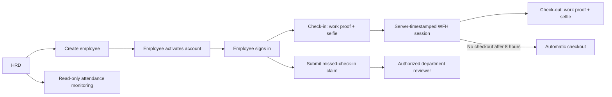
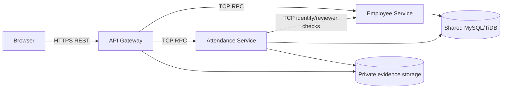

# DexaWork — WFH Attendance and Employee Management

DexaWork is a web application for employee WFH check-in/check-out, private evidence review, HRD employee administration, and department-scoped missed-check-in claims. This repository contains a React TypeScript frontend and a NestJS TypeScript backend with MySQL/TiDB.

The documentation distinguishes the **current implementation** from the initial PRD and architecture blueprint. Those original files remain for historical requirement traceability; the as-built documents linked below describe what the code currently does.

## Product flows

Evidence is private and accessed through authenticated backend routes. Captures are for human review and do not prove identity or location. Official event times come from the server. HRD cannot edit or delete submitted attendance.

## Runtime architecture

The three NestJS applications run as separate processes. Current production startup groups them in one backend service; they share a database instance, so this is not database-isolated microservices.

## Documentation

- [Backend README](backend/README.md): backend setup, operational commands, runtime map, current architecture and ERD.
- [Frontend README](frontend/README.md): frontend structure, flows, development, build and Vercel configuration.
- [Current product scope](backend/docs/CURRENT_PRODUCT_SPEC.md): as-built functional requirements, roles and acceptance behavior.
- [Architecture and ERD](backend/docs/ARCHITECTURE_AND_ERD.md): runtime diagram, sequence, modules and database model visualization.
- [HTTP and RPC contracts](backend/docs/API_RPC_CONTRACTS.md): public API, internal TCP patterns, validation, errors and request IDs.
- [Data ownership](backend/docs/DATA_OWNERSHIP.md) and [module map](backend/docs/MODULE_MAP.md).
- [Backend clean-code audit](backend/docs/CLEAN_CODE_AUDIT.md): verified strengths, gaps, targeted cleanup and follow-up priorities.
- [Initial PRD](backend/02_PRD.md) and [initial architecture blueprint](backend/03_ARCHITECTURE.md) are historical baseline documents, not the current implementation contract.

## Local start

Follow the detailed setup in the [backend README](backend/README.md), then start the frontend in another terminal using the [frontend README](frontend/README.md). Local URLs are `http://localhost:5173` for the UI, `http://localhost:3000/api/v1` for REST, and `http://localhost:3000/api/docs` for Swagger.
