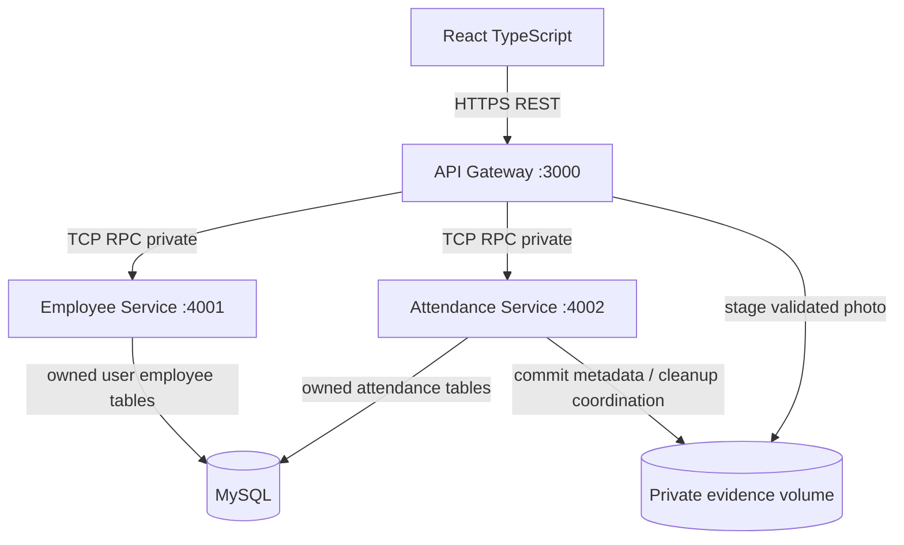
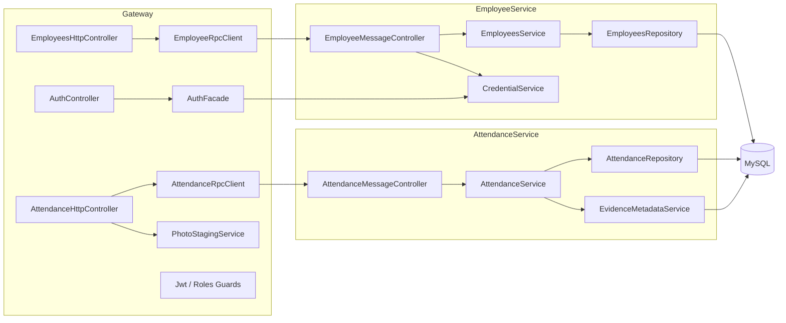
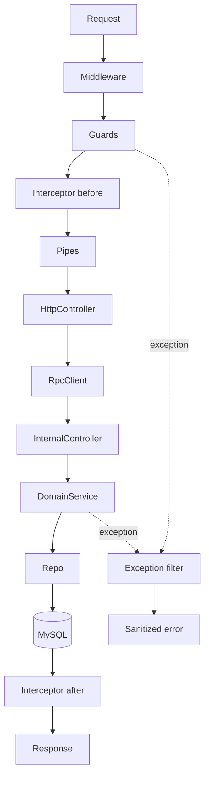
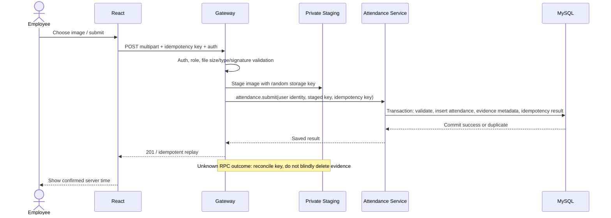
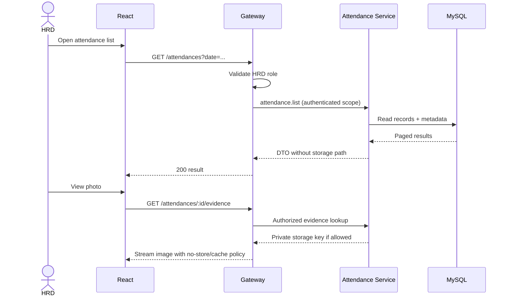

# PharmaWork Backend — Architecture Decision & Folder Blueprint

> **Status: Initial architecture blueprint, retained for traceability.** The running repository uses the three NestJS processes and REST/TCP topology, but feature and storage details have evolved. For the as-built system, see [current architecture and ERD](docs/ARCHITECTURE_AND_ERD.md), [module map](docs/MODULE_MAP.md), and [data ownership](docs/DATA_OWNERSHIP.md).

**Architecture:** NestJS monorepo, three independent processes, TCP request/response, MySQL (shared instance with logical table ownership), private photo storage.

## 1. Context and constraints
The skill-test brief requires an API with a **microservices concept** rather than prescribing a broker, database-per-service, or orchestration stack. Therefore the fastest defensible implementation is a *microservice demonstration*: separate NestJS applications/processes for the HTTP Gateway, Employee Service, Attendance Service. The shared MySQL instance makes it a **transitional microservice architecture**, *not* independently deployable data-isolated microservices.

### Logical system


### Physical decisions
- **Gateway**: public HTTP; login, cookies/JWT, HTTP DTO validation, file upload boundary, authorization, request ID, Swagger. Does **not** implement business rules directly.
- **Employee Service**: owns user credentials, employees, fixed department enum, employee CRUD, active status, credential verification; internal RPC only.
- **Attendance Service**: owns attendance/evidence metadata, duplicate protection, server timestamp, read-only monitoring queries; internal RPC only.
- **Database**: MySQL 8.0+, one instance for MVP; Prisma migration executed from a single schema/migration owner. Application services should use repositories restricted to their owned tables.
- **Photo storage**: private local volume for test demo; path never reachable by public static server. In container topology, the Gateway needs staging write and the Attendance Service needs read/finalize or the Gateway must perform storage finalization after RPC. Choose one protocol and test recovery. This blueprint chooses **Gateway stages, Attendance Service commits metadata; Gateway performs cleanup on definitive failure, sweeper handles unknown outcomes**.
- **TCP**: private Docker network, RPC timeout, error translation and correlation/request IDs.

## 2. C4-ish component view


## 3. Folder structure (target repository; proposed, not yet generated application source)
```text
pharmawork/
├── README.md                          # Runbook: install, env, migrate, test, demo
├── package.json                       # NestJS monorepo workspace scripts
├── package-lock.json                  # Locked dependency tree (commit)
├── nest-cli.json                      # projects: gateway, employee, attendance
├── tsconfig.json
├── tsconfig.build.json
├── eslint.config.mjs
├── .env.example                       # Never commit .env
├── .gitignore
├── prisma.config.ts                   # Prisma CLI datasource URL
├── prisma/
│   ├── schema.prisma                  # Central migration owner for MVP
│   ├── migrations/                    # Generated SQL migration history
│   └── seed.ts                        # Synthetic demo accounts/data
├── generated/prisma/                  # Generated client; version-specific
├── apps/
│   ├── api-gateway/
│   │   ├── src/main.ts                # HTTP bootstrap, prefix, cookie/CORS, pipes, Swagger
│   │   ├── src/app.module.ts
│   │   ├── src/auth/
│   │   │   ├── auth.module.ts
│   │   │   ├── auth.controller.ts      # POST login/logout, GET me
│   │   │   ├── auth.service.ts         # RPC credential validation, token issuer
│   │   │   └── dto/login.dto.ts
│   │   ├── src/employees/
│   │   │   ├── employees.module.ts
│   │   │   ├── employees.controller.ts # REST CRUD; HRD only
│   │   │   └── employee-rpc.service.ts
│   │   ├── src/attendance/
│   │   │   ├── attendance.module.ts
│   │   │   ├── attendance.controller.ts # multipart upload, self/HRD read
│   │   │   └── attendance-rpc.service.ts
│   │   ├── src/evidence/
│   │   │   ├── evidence.module.ts
│   │   │   └── photo-staging.service.ts
│   │   ├── src/common/
│   │   │   ├── guards/jwt-auth.guard.ts
│   │   │   ├── guards/roles.guard.ts
│   │   │   ├── decorators/current-user.decorator.ts
│   │   │   ├── decorators/roles.decorator.ts
│   │   │   ├── middleware/request-id.middleware.ts
│   │   │   ├── pipes/                 # only when DTO/file validation insufficient
│   │   │   ├── interceptors/logging.interceptor.ts
│   │   │   └── filters/http-exception.filter.ts
│   │   └── test/                      # Gateway e2e tests
│   ├── employee-service/
│   │   ├── src/main.ts                # createMicroservice TCP port 4001
│   │   ├── src/app.module.ts
│   │   ├── src/employees/
│   │   │   ├── employees.module.ts
│   │   │   ├── employees.message-controller.ts
│   │   │   ├── employees.service.ts
│   │   │   ├── employees.repository.ts
│   │   │   └── dto/                   # internal validation boundary
│   │   ├── src/credentials/
│   │   │   └── credentials.service.ts
│   │   └── test/
│   └── attendance-service/
│       ├── src/main.ts                # createMicroservice TCP port 4002
│       ├── src/app.module.ts
│       ├── src/attendance/
│       │   ├── attendance.module.ts
│       │   ├── attendance.message-controller.ts
│       │   ├── attendance.service.ts
│       │   ├── attendance.repository.ts
│       │   └── attendance-policy.service.ts
│       ├── src/evidence/
│       │   ├── evidence.service.ts    # private metadata and retrieval authorization
│       │   └── orphan-sweeper.service.ts  # optional follow-up hardening
│       └── test/
├── libs/
│   ├── contracts/src/
│   │   ├── employee.messages.ts       # typed RPC patterns
│   │   ├── attendance.messages.ts
│   │   ├── dto/
│   │   │   ├── employee.dto.ts
│   │   │   └── attendance.dto.ts
│   │   └── response.types.ts
│   └── common/src/
│       ├── errors/domain-error.ts
│       ├── security/role.enum.ts
│       └── constants/timezone.ts
├── infra/
│   ├── docker-compose.yml             # MySQL and optional local services
│   └── Dockerfile.*                    # generated after implementation
├── docs/
│   ├── 01_BRD.md
│   ├── 02_PRD.md
│   ├── 03_ARCHITECTURE.md
│   ├── 04_API_AND_DATA.md
│   └── 05_AGENT_HANDOFF.md
└── tests/
    ├── integration/
    └── e2e/
```

**Naming note:** npm/Node path alias configuration for `libs/*` must be explicitly wired in Nest CLI and tsconfig; folders alone do not enable importing libraries.

## 4. Responsibilities: modules / controllers / providers / repositories
| Layer | What it owns | Example |
|---|---|---|
| Nest `Module` | Dependency registration, imports, exports | `AttendanceModule` registers services/providers |
| HTTP `Controller` | Route, HTTP DTO, current user, status, multipart; delegates | Gateway `AttendanceController` |
| RPC `MessageController` | `@MessagePattern` internal transport and response | `attendance.submit` |
| `Service` | Business policy, orchestration, transactions | `AttendanceService.submit` |
| `Repository` | Persistence interface/Prisma query | `AttendanceRepository.insertOnce` |
| `Provider` | Injectable dependency | Prisma, password hasher, evidence storage, RpcClient |
| DTO | Boundary validation/type contract | `SubmitAttendanceRequestDto` |
| Guard | Authenticate/authorize request | `JwtAuthGuard`, `RolesGuard` |
| Pipe | Validate/transform payload/file | `ValidationPipe`, `ParseFilePipe` |
| Interceptor | Cross-cutting before/after around execution | request duration logger |
| Filter | Map safe exceptions to response | `HttpExceptionFilter` |
| Middleware | Pre-route request correlation | `RequestIdMiddleware` |

### Request lifecycle

The microservice receiver has its own transport/runtime exception handling. An HTTP guard **does not** automatically run in the downstream TCP process: trust boundaries and authenticated caller context must be designed explicitly.

### Nest application lifecycle (not request lifecycle)
- `onModuleInit()` and `onApplicationBootstrap()` for initial resource setup.
- `onModuleDestroy()`, `beforeApplicationShutdown()`, `onApplicationShutdown()` for cleanup; call `enableShutdownHooks()` where appropriate.
- Avoid DB connectivity in every request if a singleton/pooled provider can be initialized once.

## 5. Sequence: authenticated attendance with evidence


**Critical recovery:** If the RPC times out, the gateway must *not* delete a staged file until it knows the attendance transaction did not commit. Use a durable idempotency record; later reconciliation or sweeper removes safe-to-delete files. The shared storage path is an MVP convenience; in production, prefer S3-compatible private object storage and asynchronous orphan cleanup.

## 6. Sequence: HRD monitoring


## 7. Service contracts and trust boundaries
- **HTTP trust boundary:** gateway verifies cookie/JWT, CSRF, payload, role.
- **Internal RPC trust boundary:** private network, no publicly reachable TCP endpoints; pass authenticated principal in an internal envelope and validate source/service caller. Do not trust an arbitrary `role` from browser input.
- **Employee ownership:** Employee Service owns `users`, `employees`, the fixed `DepartmentCode` enum and credential verification; Attendance Service receives verified employee identity and enum department rather than querying password data.
- **Attendance ownership:** Attendance Service owns `attendances`, `attendance_evidence`, attendance idempotency records. HRD has read operations only.
- **Shared schema trade-off:** physical foreign keys support integrity but couple services. With database-per-service, use immutable employee references, events, and eventual consistency. That migration is future work.

## 8. Engineering decisions (ADRs)
| ID | Decision | Reason | Tradeoff |
|---|---|---|---|
| ADR-001 | Three independent Nest apps | Genuine process boundary for microservice-concept demonstration | More local startup complexity |
| ADR-002 | TCP RPC | Built-in Nest transport, fast for MVP | No durable message broker / needs timeouts |
| ADR-003 | MySQL + Prisma | Test preference, migrations and typed queries | Prisma 7 adapter/ESM setup must be consistent |
| ADR-004 | Shared MySQL instance | 3–5-day implementation constraint | Not isolated data ownership / coordinated migrations |
| ADR-005 | Server timestamps, Asia/Jakarta workDate | Avoid browser time spoofing | Define timezone and clock convention |
| ADR-006 | Private photo storage | Evidence privacy, controlled access | Cleanup/reconciliation required |
| ADR-007 | Durable idempotency | Retry safety, duplicate prevention | Extra table and transaction logic |
| ADR-008 | Employee deactivation instead of physical delete | Preserve attendance FK/history | API `DELETE` semantics documented |
| ADR-009 | Redis/ERP deferred | Skill test does not require them | Less enterprise breadth in MVP |
| ADR-010 | One submission/day, no check-out | Smallest fully testable attendance use case | Shift/hybrid schedule support deferred |

## 9. Observability / resilience
- Include requestId in logs, HTTP error and RPC envelope; mask email when possible, never log photo bytes/passwords/tokens.
- Timeouts on `ClientProxy.send()`, bounded retries only for idempotent read or key-protected writes, circuit-breaker as future improvement.
- `/health` gateway plus downstream service liveness/readiness; `docker compose ps` for local triage.
- Evidence cleanup logs, duplicate conflict counters, successful submissions, RPC error counters; metrics are best-effort at MVP scale.

## 10. Official documentation anchors
- NestJS Microservices basics: https://docs.nestjs.com/microservices/basics
- NestJS request lifecycle: https://docs.nestjs.com/faq/request-lifecycle
- NestJS file upload: https://docs.nestjs.com/techniques/file-upload
- Prisma 7 MySQL: https://www.prisma.io/docs/v7/prisma-orm/quickstart/mysql
- Prisma config: https://www.prisma.io/docs/orm/v7/reference/prisma-config-reference
