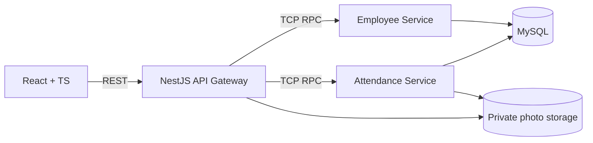

# PharmaWork Backend — Architecture & Implementation Documentation

  

**Version:** 1.0 | **Date:** 14 November 2026 | **Purpose:** Fullstack Developer Skill Test + engineering/AI-agent handoff

> ⚠️ **Documentation package, not a finished backend.** This repository folder currently contains specifications, a sample MySQL Compose service, and an environment template. The proposed `apps/`, `libs/`, `prisma/` source tree and npm commands below are **implementation instructions**, not code that exists yet. Do not claim the API is running or tests passing until an implementation has been created and verified.

## 1. What is PharmaWork?
A WFH employee-attendance web application. An employee logs in and submits attendance with **server-captured date/time** and a **photo proving work at home**. HRD manages master employee records via CRUD APIs and **only views** submitted attendance and photos. Built with React frontend and TypeScript/NestJS backend; database preference MySQL. Microservices concept is shown via distinct Gateway, Employee Service and Attendance Service processes.

**Authoritative requirement:** `Ketentuan_Aplikasi_WFH.pdf` (*FULLSTACK DEVELOPER SKILL TEST*) — 3–4 days target, 5 days maximum. Backend docs do **not** replace this source. Functional scope items absent from that brief are labeled implementation choices in BRD/PRD.

## 2. Documentation index
| File | Audience | Contents |
|---|---|---|
| [Business Requirements (BRD)](docs/01_BRD.md) | Product, business, reviewer | Goals, actor scope, source traceability, business rules, MVP boundary |
| [Product Requirements (PRD)](docs/02_PRD.md) | PM, engineers, QA | FR/NFR IDs, user stories, acceptance criteria, error cases, DoD |
| [Architecture](docs/03_ARCHITECTURE.md) | Backend developers | Diagrams, 3 Nest apps, folder tree, DI/lifecycle, service boundaries, ADRs |
| [API + Database](docs/04_API_AND_DATA.md) | Frontend/backend/QA | REST endpoints, RPC patterns, request/response, MySQL entities, constraints, Prisma policy |
| [AI Agent Handoff](docs/05_AGENT_HANDOFF.md) | Coding agent | Implementation order, guardrails, output/test expectations |
| [Sample Docker Compose](infra/docker-compose.yml) | Developers | **MySQL-only** local infrastructure, not backend service image |
| [Environment template](.env.example) | Developers | Placeholder variables only; no real secrets |

## 3. Architecture at a glance


**Decision:** Three NestJS application processes, shared MySQL instance with logical table ownership. This demonstrates microservice concepts and is *not* a claim of fully isolated database-per-service microservices. Redis and ERP integrations are deferred until required features pass.

## 4. Core roles and permissions
| Operation | EMPLOYEE | HRD |
|---|:---:|:---:|
| Login / me | ✅ | ✅ |
| Submit WFH attendance with photo | ✅ Own | ❌ |
| View attendance | ✅ Own | ✅ All authorized |
| View private evidence image | ✅ Own | ✅ All authorized |
| Create / update / deactivate employee | ❌ | ✅ |
| Modify / delete submitted attendance | ❌ | ❌ |

## 5. Intended tech stack
- Node.js LTS compatible with the **pinned** NestJS/Prisma versions (verify compatibility before installing).
- TypeScript strict; NestJS HTTP (Express adapter) plus NestJS TCP microservices.
- MySQL 8+; Prisma ORM 7 + `@prisma/adapter-mariadb` (or one consistently pinned alternative).
- Authentication using securely issued token/session; server-side password hashing and role guards.
- Local private evidence volume for skill-test demo; MinIO/S3-compatible storage if deploying.
- React + TypeScript + Tailwind UI uses gateway REST endpoints.

## 6. Prepare local infrastructure (available in this documentation package)
Prerequisites: Docker Engine/Compose plugin; a free local port `3306`. Keep real credentials out of Git.

```bash
# Run from this documentation folder
cp .env.example .env
# Edit .env: choose unique MySQL credentials, set matching DATABASE_URL
# Start only the database (this Compose does NOT start NestJS)
docker compose --env-file .env -f infra/docker-compose.yml up -d mysql
# Check container and health
docker compose --env-file .env -f infra/docker-compose.yml ps
# Stop without deleting database data
docker compose --env-file .env -f infra/docker-compose.yml down
```

If another MySQL server occupies 3306, change `MYSQL_HOST_PORT` and `DATABASE_URL` consistently. Inside the Docker network, hostname is `mysql` and port `3306`; on the host, use `127.0.0.1` and `MYSQL_HOST_PORT`.

## 7. Proposed backend generation / setup (NOT YET IMPLEMENTED)
After creating the NestJS workspace and three applications as specified in [Architecture](docs/03_ARCHITECTURE.md), the **target** scripts are:

```bash
# Future scripts — will NOT work until package.json, Nest apps and Prisma are implemented
npm ci
npm run prisma:generate
npm run prisma:migrate:dev
npm run prisma:seed
npm run start:dev:employee
npm run start:dev:attendance
npm run start:dev:gateway
npm run test
npm run test:e2e
npm run lint
```

Target `package.json` scripts should map to verified Nest CLI project names and Prisma CLI commands. `npm ci` requires the generated `package-lock.json`. Do not run `prisma migrate dev` against production; use `prisma migrate deploy` in deployment. Prisma 7 CLI datasource configuration and runtime driver adapter details are documented in [API + Data](docs/04_API_AND_DATA.md).

### Suggested development boot order
1. Boot MySQL and verify health.
2. Install/pin NestJS and Prisma toolchain; configure ESM/module compatibility and environment validation.
3. Define Prisma schema, generate migration, run seed with synthetic demo users only.
4. Start Employee Service (`:4001`, TCP) and Attendance Service (`:4002`, TCP).
5. Start API Gateway (`:3000`, HTTP); verify internal clients can connect.
6. Connect React UI to `http://localhost:3000/api/v1` (dev only).

### Environment variables
Copy `.env.example`. Set **real local values** in `.env`, which must be gitignored. For Docker Compose the MySQL credentials are injected through `.env`; verify that special characters are URL-encoded in `DATABASE_URL`.

| Variable | Purpose |
|---|---|
| `MYSQL_ROOT_PASSWORD` | Local DB root secret; never hardcode publicly |
| `MYSQL_DATABASE` | Database name |
| `MYSQL_USER`, `MYSQL_PASSWORD` | App DB credentials |
| `MYSQL_HOST_PORT` | MySQL port exposed to host |
| `DATABASE_URL` | Prisma CLI DB connection URL |
| `DATABASE_HOST` etc. | Prisma runtime MariaDB driver parameters |
| `JWT_SECRET` | Signed authentication token secret |
| `API_PORT` | Gateway HTTP port |
| `EMPLOYEE_SERVICE_HOST/PORT` | Internal TCP address |
| `ATTENDANCE_SERVICE_HOST/PORT` | Internal TCP address |
| `EVIDENCE_STORAGE_DIR` | Private image storage path |
| `CORS_ORIGIN` | Allowed frontend origin |

## 8. Target API endpoints (after implementation)
| Method | Endpoint | Scope |
|---|---|---|
| POST | `/api/v1/auth/login` | Public |
| POST | `/api/v1/auth/logout` | Auth |
| GET | `/api/v1/auth/me` | Auth |
| POST | `/api/v1/employees` | HRD |
| GET | `/api/v1/employees` | HRD |
| GET | `/api/v1/employees/:id` | HRD |
| PATCH | `/api/v1/employees/:id` | HRD |
| DELETE | `/api/v1/employees/:id` | HRD (deactivate) |
| POST | `/api/v1/attendances` | Employee + photo |
| GET | `/api/v1/attendances/me` | Employee self |
| GET | `/api/v1/attendances/me/today` | Employee self |
| GET | `/api/v1/attendances` | HRD view-only |
| GET | `/api/v1/attendances/:id` | Owner / HRD |
| GET | `/api/v1/attendances/:id/evidence` | Owner / HRD |

See [API + Data](docs/04_API_AND_DATA.md) for detailed payloads and RPC patterns. Once implemented, publish Swagger at `/api/docs` with authentication and photo multipart documented.

## 9. Demo walkthrough / reviewer checklist
**After implementation**, start the frontend and all backend processes using documented commands and seeded synthetic users.

1. Log in as HRD and create a new employee record.
2. Verify employee appears in searchable master data list; update the record.
3. Log out; log in as that Employee.
4. Submit WFH attendance with a valid photo (e.g., local sample JPEG), note timestamp returned by server.
5. Attempt same-day duplicate; receive conflict (or same result with same key).
6. Log in as HRD, open attendance list, select the submission, and view private evidence.
7. Try to mutate attendance as HRD: request must be denied or route absent.
8. Try to view another employee's attendance as Employee: must be forbidden.
9. Deactivate employee as HRD; previous attendance still available to HRD; disabled user cannot log in.
10. Show MySQL rows, migration history, gateway-to-service RPC logs and tests.

## 10. Testing targets
- **Unit:** business rules, date/time conversion, permission checks, DTO helpers.
- **Integration:** MySQL unique(employeeId, workDate), transaction behavior, idempotency key, create/update/deactivate employee.
- **E2E:** login, photo upload, evidence read authorization, HRD monitor read-only, invalid file, duplicate submission, RPC failure.
- **Accessibility:** web frontend WCAG 2.2 AA target. Backend enables accessible human-readable error messages; testing lives in UI project.

## 11. Security and privacy checklist
- [ ] JWT/session signature validated and expired credentials rejected
- [ ] Secrets in `.env` only; `.env` gitignored
- [ ] Hash passwords using Argon2id or bcrypt; never log passwords
- [ ] Restrict internal TCP ports to private interfaces / Docker network
- [ ] Authorize each resource: owner versus HRD
- [ ] Validate file size, MIME type AND actual magic bytes
- [ ] Store photo privately; stream only through authorized endpoint
- [ ] Use CSRF protection if using cookie authentication
- [ ] Log request IDs and safe metadata, not photo contents or secrets
- [ ] DB unique constraints and transaction protect duplicates
- [ ] Reconcile staged images after timeout/crash
- [ ] Never accept employeeId or submittedAt from browser for attendance

## 12. Known assumptions and explicit exclusions
- One WFH attendance with one image per employee per local day; **design assumption**, not specified verbatim by brief.
- No check-out or supervisor approval is required by source.
- No ERP or Redis is required by source.
- MySQL is preferred rather than obligatory; chosen as implementation design.
- Image JPEG/PNG/WebP and max 5 MiB are chosen policy, not mandated by source.
- Local timezone Asia/Jakarta for work date; timestamp stored as UTC.

## 13. Troubleshooting guide (when apps are built)
| Symptom | First check |
|---|---|
| MySQL connection refused | `docker compose ps`, port conflict, DB readiness, hostname from host vs container |
| Prisma `DATABASE_URL` error | `.env` loaded in `prisma.config.ts`, URL encoding, schema path |
| Prisma runtime fails | matching Prisma versions, `@prisma/adapter-mariadb`, generated client and ESM config |
| Gateway RPC timeout | downstream process running, correct host/port, message pattern spelling |
| 401 after login | cookie/Authorization header, JWT secret, expiry, frontend credentials configuration |
| 403 HRD/Employee | verified principal and role/record ownership, service authorization scope |
| Upload 413 | gateway file size, reverse proxy max body size, upload limits |
| Image not visible | private storage mount, authorization endpoint, storage key lookup, no public URL assumption |
| Duplicate attendance | verify `@@unique([employeeId,workDate])` migration installed and idempotency key persistence |
| Unexpected local work date | server/database UTC config and `Asia/Jakarta` date calculation |

## 14. Project completion / review
The skill test is **complete** only once the running React UI calls these actual NestJS endpoints, the three processes can be demonstrated, and all core use cases pass. The presence of this documentation package alone does not satisfy the development test.

### Official references
- NestJS: https://docs.nestjs.com/
- NestJS Microservices: https://docs.nestjs.com/microservices/basics
- NestJS File Upload: https://docs.nestjs.com/techniques/file-upload
- Prisma 7 + MySQL: https://www.prisma.io/docs/v7/prisma-orm/quickstart/mysql
- Prisma Config: https://www.prisma.io/docs/orm/v7/reference/prisma-config-reference
