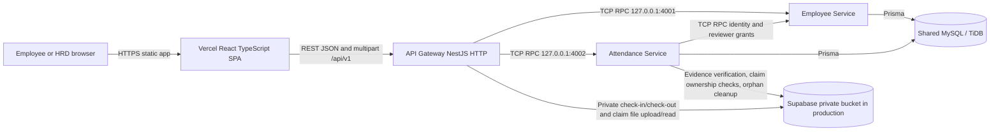
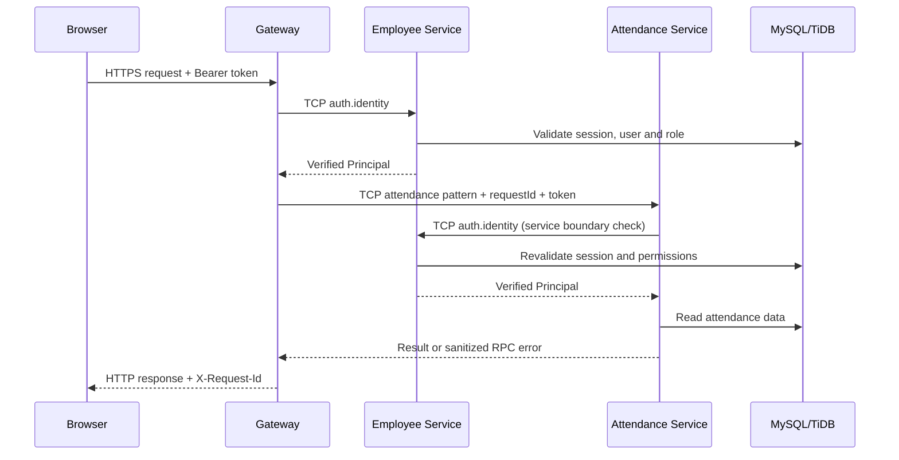

# DexaWork — Current Architecture and ERD

**Status:** as-built architecture · **Last verified:** 17 November 2026

The repository keeps the approved **React → HTTP REST → NestJS API Gateway → TCP RPC → NestJS internal services** topology. The three Nest applications are separate processes, but production currently starts them together in one Render service. They share one Prisma schema and MySQL-compatible database; this is an MVP boundary, not database-per-service isolation.

## Runtime architecture



In development, `PhotoStorage` uses the local private storage adapter unless `PHOTO_STORAGE_PROVIDER` is set. In production, it defaults to Supabase and requires the private bucket and server-side credentials. The browser does not receive a public bucket URL; evidence goes through authenticated API routes.

### Request sequence: protected attendance read



This intentionally documents the current duplicate identity check. It is a security boundary; do not remove it as a latency cleanup without a separately reviewed authentication design.

## Application and module map

| Runtime application | Actual module/folder | Responsibility | Outbound dependency |
|---|---|---|---|
| API Gateway (`apps/api-gateway`) | `auth` | Login, activation, logout, current principal response; login delegates through `AuthService`. | Employee Service RPC |
| API Gateway | `employees` | HTTP employee endpoints; forwards validated requests over RPC. | Employee Service RPC |
| API Gateway | `attendance` | HTTP attendance endpoints, multipart capture staging, evidence streaming, HRD monitoring routes. | Attendance Service RPC; `PhotoStorage` |
| API Gateway | `attendance-claims` | Claim creation, personal list, reviewer queue and decisions. | Attendance Service RPC |
| API Gateway | `common` | Shared RPC client, storage adapter, authenticated request context, HTTP exception filter. | TCP RPC, Supabase/local storage |
| Employee Service (`apps/employee-service`) | `employees` + `credentials` | Credential/session validation, activation, employee lifecycle, employee number allocation and audit events. | MySQL/TiDB; TCP RPC client for trusted boundaries |
| Attendance Service (`apps/attendance-service`) | `attendance` | Check-in/out, history, monitoring queries, evidence metadata, automatic checkout. | MySQL/TiDB, Employee Service RPC, storage |
| Attendance Service | `claims` | Missed-check-in claim lifecycle and department-scoped review. | MySQL/TiDB, Employee Service RPC |
| Attendance Service | `evidence` | Aged orphan evidence cleanup. | MySQL/TiDB and storage |

`@Module()` classes are in-process DI compositions. The separately started Gateway, Employee, and Attendance applications are the runtime process boundaries. `libs/contracts` contains shared DTOs, principal/envelope types and pattern names; `libs/common` contains shared infrastructure helpers.

## ERD — current Prisma models

```mermaid
erDiagram
  USER ||--o| EMPLOYEE : "employee account"
  USER ||--o{ SESSION : "authenticated sessions"
  USER ||--o| ACTIVATION_TOKEN : "pending activation"
  USER ||--o{ MISSED_CHECK_IN_REVIEW_GRANT : "review scope"
  EMPLOYEE ||--o{ ATTENDANCE : "work sessions"
  EMPLOYEE ||--o{ MISSED_CHECK_IN_CLAIM : "claim owner"
  USER o|--o{ MISSED_CHECK_IN_CLAIM : "reviewer"
  ATTENDANCE ||--o{ EVIDENCE : "private session evidence metadata"
  MISSED_CHECK_IN_CLAIM ||--o| MISSED_CHECK_IN_CLAIM_EVIDENCE : "one private file attachment"
  ATTENDANCE ||--o| IDEMPOTENCY : "direct submission key"
  ATTENDANCE o|--o| MISSED_CHECK_IN_CLAIM : "attendance created on approval"

  USER {
    char36 id PK
    varchar191 email UK
    varchar255 passwordHash
    enum role
    boolean active
  }
  EMPLOYEE {
    char36 id PK
    char36 userId FK_UK
    varchar50 employeeNumber UK
    varchar150 fullName
    enum department
    varchar100 position
    boolean active
  }
  SESSION {
    char36 id PK
    char36 userId FK
    datetime expiresAt
    boolean revoked
  }
  ACTIVATION_TOKEN {
    char36 id PK
    char36 userId FK_UK
    char64 tokenHash UK
    datetime expiresAt
    datetime usedAt
  }
  EMPLOYEE_NUMBER_SEQUENCE {
    int id PK
    datetime createdAt
  }
  ATTENDANCE {
    char36 id PK
    char36 employeeId FK
    char50 employeeNumberSnapshot
    enum departmentSnapshot
    char10 workDate
    datetime submittedAt
    datetime checkOutAt
    enum source
    enum checkOutType
    text activityDescription nullable
  }
  EVIDENCE {
    char36 id PK
    char36 attendanceId FK
    enum kind
    enum workProofType
    char36 storageKey UK
    varchar50 mimeType
    int size
    char64 sha256
    datetime recordedAt
  }
  IDEMPOTENCY {
    char36 id PK
    char36 employeeId
    varchar100 key
    char64 fingerprint
    char36 attendanceId FK_UK
  }
  MISSED_CHECK_IN_REVIEW_GRANT {
    char36 id PK
    char36 userId FK
    enum department
    varchar64 permission
  }
  AUDIT_EVENT {
    char36 id PK
    char36 actorId
    char36 employeeId
    varchar64 action
    json changes
    datetime createdAt
  }
  MISSED_CHECK_IN_CLAIM {
    char36 id PK
    char36 employeeId FK
    char10 workDate
    varchar5 claimedCheckInTime
    varchar5 claimedCheckOutTime
    enum status
    datetime requestedAt
    datetime reviewedAt
    char36 reviewedByUserId FK
    char36 attendanceId FK_UK
    varchar100 idempotencyKey
  }
  MISSED_CHECK_IN_CLAIM_EVIDENCE {
    char36 id PK
    char36 claimId FK_UK
    char36 storageKey UK
    varchar50 mimeType
    int size
    char64 sha256
    datetime recordedAt
  }
```

`DepartmentCode`, `Role`, attendance source, evidence kind, work-proof type, checkout type and claim status are Prisma enums, not lookup tables. `AuditEvent` stores `actorId` and `employeeId` as identifiers plus JSON changes; the current Prisma schema does not declare relational FKs for those audit identifiers. Evidence bytes are held in the configured private storage provider; `Evidence` and `MissedCheckInClaimEvidence` store metadata and storage keys, while file bytes remain in private object/file storage.

## Data ownership and shared-database caveat

Logical write ownership is Employee Service for accounts/employees/sessions/activation/audit and Attendance Service for attendance/evidence/idempotency/claims/claim attachments/review grants. One shared Prisma client schema and database credentials mean this ownership is conventional, not enforced at the DB permission level. The HR monitoring read methods in Attendance Service currently query a limited Employee/User projection for status tables. This is a documented read-side coupling and a clean-boundary improvement candidate; do not describe the services as data-isolated.

See [DATA_OWNERSHIP.md](DATA_OWNERSHIP.md), [MODULE_MAP.md](MODULE_MAP.md), and [API_RPC_CONTRACTS.md](API_RPC_CONTRACTS.md) for detail.
