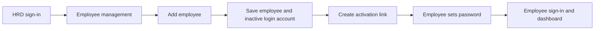
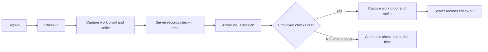
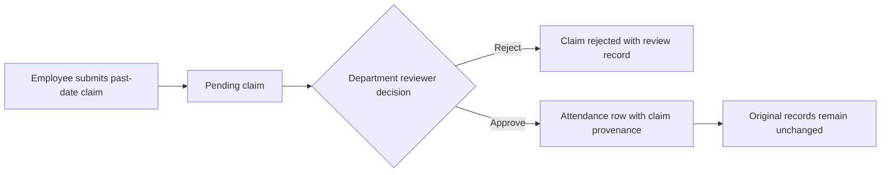

# DexaWork — Product Scope (As Built)

**Status:** current implementation snapshot · **Audience:** product, HR, engineering · **Last verified:** 17 November 2026

This document describes behavior present in the repository. It is not a replacement for the original business source documents. If the historical backend PRD or architecture blueprint differs from the running implementation, use this as-built snapshot and the linked code contracts to understand the current application.

## Product purpose

DexaWork gives employees a browser-based way to record WFH sessions and gives HRD a read-only view of those records. HRD also maintains employee accounts. A separate, permission-scoped claim flow handles a forgotten check-in on a previous workday.

## Actors and access

| Actor | Current capabilities |
|---|---|
| Employee | Activate an account, sign in, check in/out with paired visual evidence, view own session history and evidence, submit a missed-check-in claim. |
| HRD | Create/edit/deactivate employee accounts, monitor attendance and private evidence, review claims only when an explicit department grant is present. HRD cannot edit or delete submitted attendance. |
| Missed-check-in reviewer | An HRD identity with a `MISSED_CHECK_IN_CLAIM_REVIEW` grant for one or more departments. Cannot review their own claim. |

Departments are fixed enum values: Sales, Marketing, Production, Finance, HR, IT, R&D, Logistic, Administration & Secretary, and Design Department.

## Functional requirements represented in the current code

| ID | Requirement | Acceptance behavior |
|---|---|---|
| PW-01 | Authentication and activation | Active users sign in; newly created employee accounts set their own password through a one-time activation token. Sessions are checked on authenticated requests and can be revoked. |
| PW-02 | Employee administration | HRD creates, edits, and deactivates employees. Employee number is generated in the form `DEXA-{YYYY}-{DD}-{NNNN}` with a company-wide sequence. Deactivation preserves historical records. |
| PW-03 | Live WFH check-in | Employee submits a screen/workspace capture plus a separate selfie. Server time is authoritative; browser time overlays are not trusted for attendance timestamps. Duplicate submissions are protected with idempotency and a database uniqueness constraint per employee/work date. |
| PW-04 | Check-out | Employee submits a second evidence pair and may enter an optional activity description (up to 2,000 characters, no minimum). If the employee does not check out, a scheduled worker closes the session at the eight-hour due time. Automatic check-out does not manufacture photo evidence or activity text. |
| PW-05 | HR monitoring | HRD can filter and paginate attendance records, inspect session details, and retrieve private evidence through authorized backend routes. Original attendance rows are read-only to HRD. |
| PW-06 | Missed-check-in claim | Employee may claim a previous workday within the configured window (default seven days), with estimated times, reason, truth confirmation, and one required private work-progress attachment (JPEG, PNG, WebP, or PDF; max 5 MiB). A granted reviewer approves or rejects it and can view the attachment. Approval records the actual server decision time and creates a separately sourced attendance row; it does not edit an existing original row. |
| PW-07 | Private evidence | The backend validates image/PDF signature, MIME type, and size (maximum 5 MiB per upload). Evidence is stored privately (local adapter in development; Supabase Storage when configured for production) and read through authorization checks. |

## Main user flows

### HRD creates an employee account

The activation link is shown to HRD for private delivery; automatic email delivery is not implemented. The link expires after 24 hours and is single-use.

### Employee records a WFH session

The capture is visual evidence for human review. It does not prove identity, location, or that a worker remained in one place. Do not capture unrelated personal or confidential material in screen evidence.

### Employee claims a forgotten check-in

## Product boundaries and non-goals

- Direct check-in does not collect task descriptions, WFH reasons, or continuous location data.
- Browser/device clock text on a capture is not an authoritative timestamp and is not used to backdate attendance.
- No biometric verification, automated movement detection, email delivery, ERP integration, broker, or attendance-edit screen is part of the current implementation.
- Historical columns retained for compatibility are not evidence that the current UI/API collects those fields.
- This MVP does not claim a measured production latency or availability SLA.

## Security and data principles

- User identity and role are derived from the authenticated server session, not client form fields.
- An employee can access only their own attendance/evidence; HRD can inspect records but cannot mutate original attendance.
- Claim review is department-scoped and explicitly granted.
- Passwords are stored as bcrypt hashes; secrets and private evidence URLs must not appear in logs or public responses.
- Attendance event timestamps are generated by the backend. Work date is computed in Asia/Jakarta.

## Current verification

The repository's backend build and lint, plus the four Vitest unit tests, passed during the documentation and clean-code audit on 17 November 2026. This is not a load test, production deployment verification, or full browser end-to-end run.
